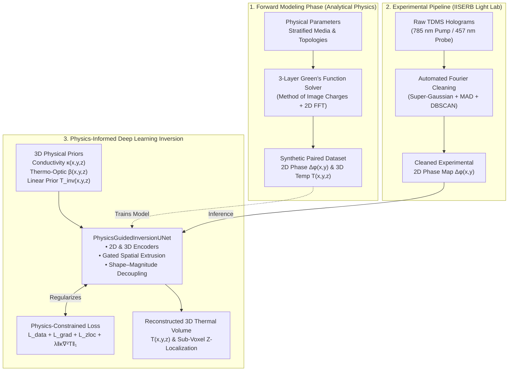
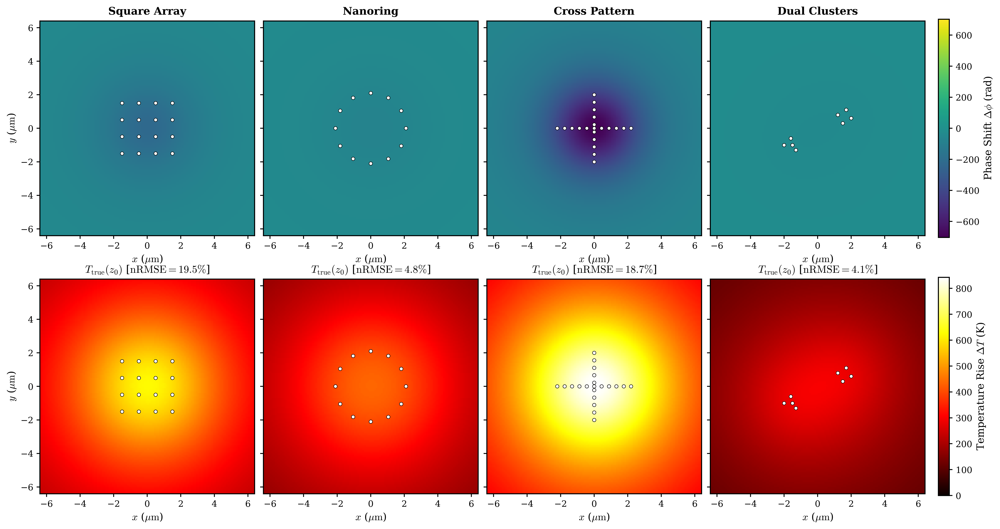
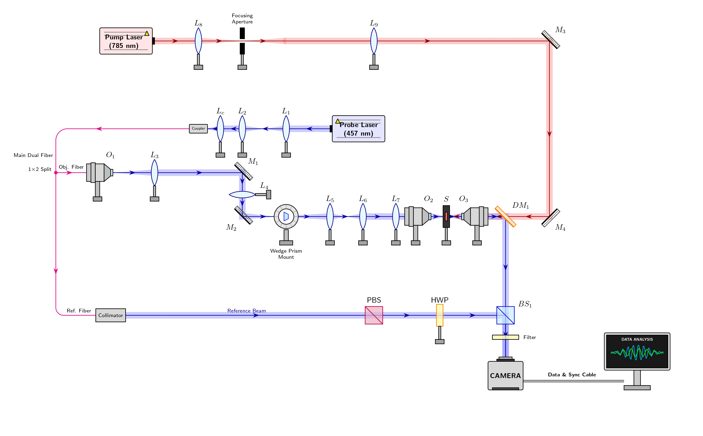
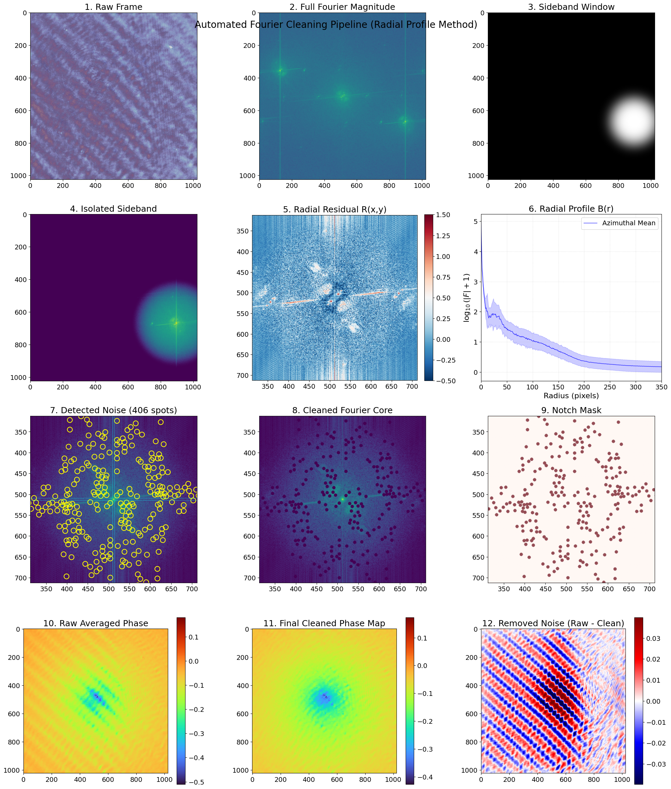
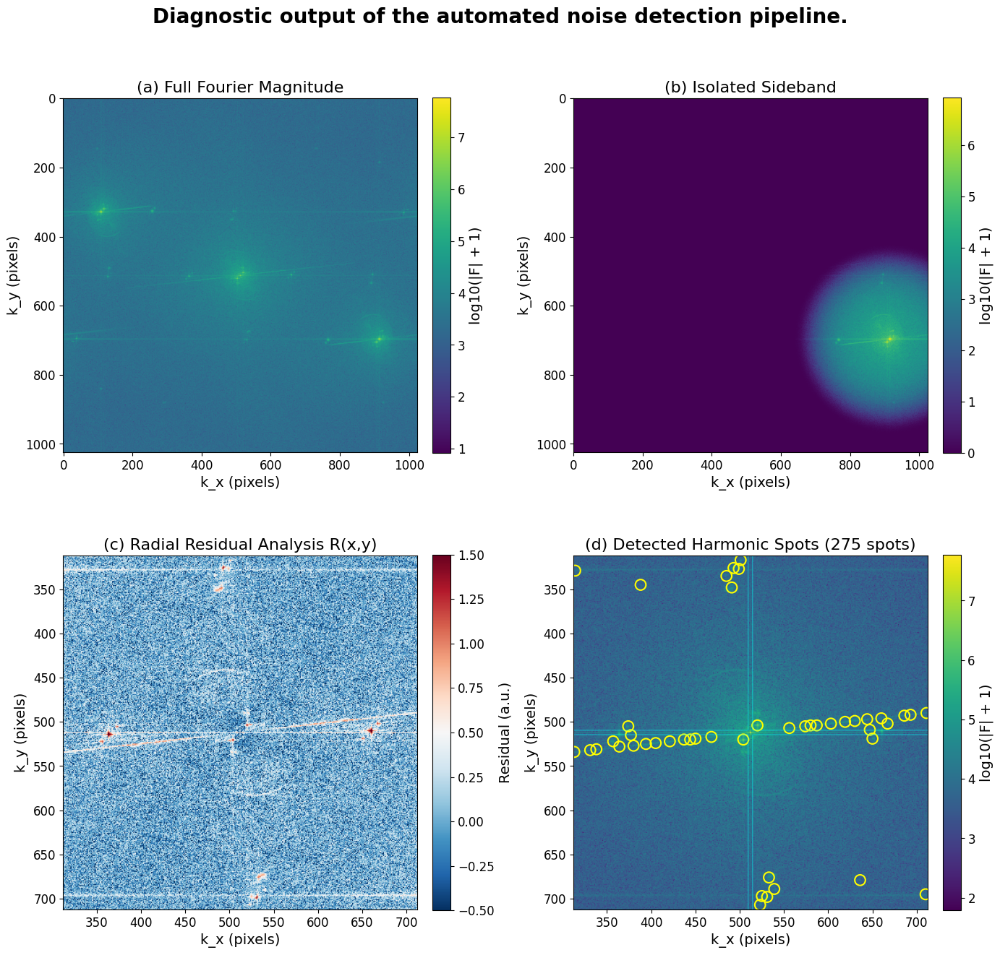
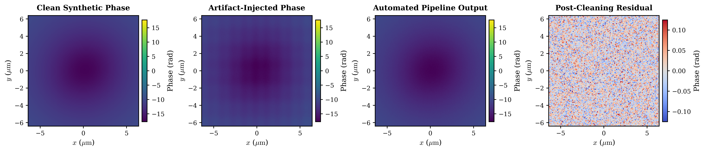
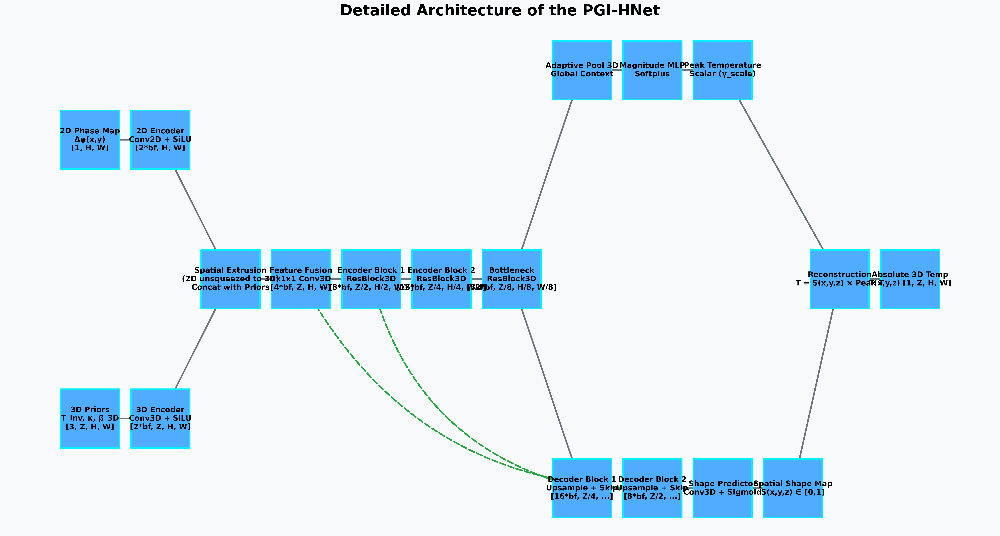
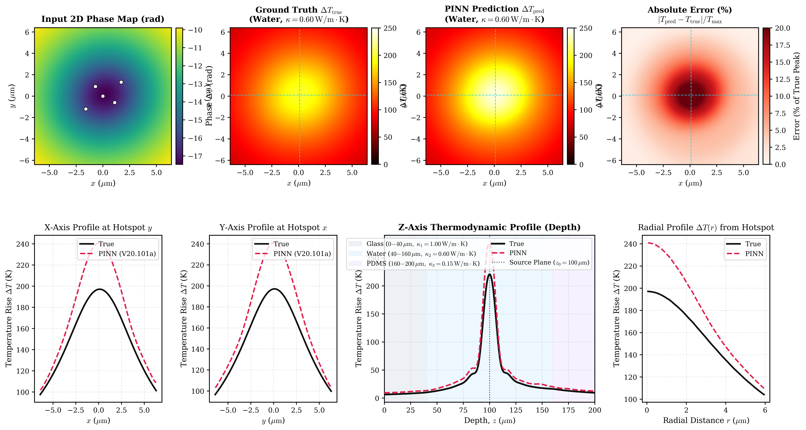
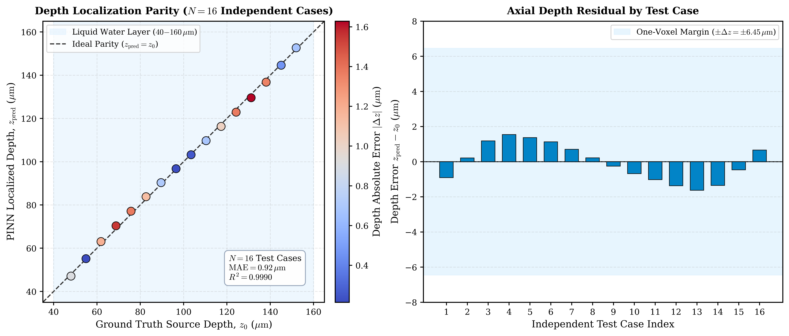
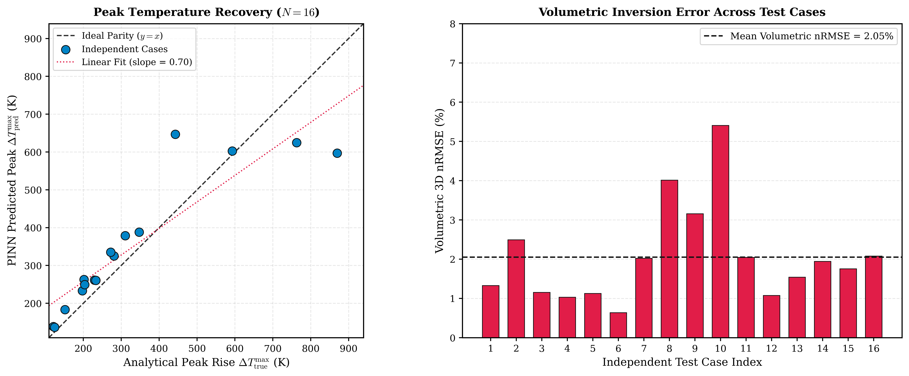

<div align="center">


# Deep Learning the Nanoscale: A Physics-Informed 3D U-Net for Solving the Thermoplasmonic Inverse Problem

**Kushagra Sinha** (Roll No. 24416) &nbsp;|&nbsp; **Supervisor:** Dr. Adarsh Vasista  
*Department of Physics, Indian Institute of Science Education and Research (IISER) Bhopal*

[](https://www.python.org/)
[](https://pytorch.org/)
[](checkpoints/pinn_latest_V20.101a.pth)
[](#5-inverse-reconstruction--benchmark-results)
[-brightgreen)](#52-axial-z-depth-source-localization)
[](LICENSE)

[**📄 Read Short Report (PDF)**](docs/short_report.pdf) &nbsp;|&nbsp; [**📘 Full BS-MS Project Report (PDF)**](docs/full_project_report.pdf) &nbsp;|&nbsp; [**💻 Source Code**](#7-repository-architecture--codebase-guide) &nbsp;|&nbsp; [**📊 Validation Figures**](#5-inverse-reconstruction--benchmark-results)

</div>

---

## 📌 Abstract

Metallic nanoparticles under laser illumination act as sub-wavelength heat sources through **Localized Surface Plasmon Resonance (LSPR)**. Quantitative Phase Imaging (QPI) techniques—such as Thermal Quadriwave Lateral Shearing Interferometry (TQSI)—map the resulting thermal landscape non-invasively by measuring the optical phase shift $\Delta\phi(x,y)$ accumulated by a probe beam traversing the thermally induced refractive-index gradient $\Delta n(T)$. However, path integration along the optical axis ($z$) collapses all three-dimensional depth information onto a 2D plane. Recovering the full volumetric temperature distribution $T(x,y,z)$ from a single 2D phase projection is a severely ill-posed inverse problem in the sense of Hadamard, further complicated in realistic experiments by stratified media (substrate–liquid–superstrate) where thermal conductivity $\kappa(z)$ varies discontinuously across planar boundaries.

This repository presents an end-to-end physics-informed deep learning framework that solves the 3D thermoplasmonic inverse problem:
1. **Analytical 3-Layer Stratified Green's Function Forward Solver (`Native3DTQSISolver`):** Derived via the method of image charges with exact thermal reflection ($R_{ij}$) and transmission ($T_{ij}$) coefficients, implemented via GPU-accelerated 2D FFT spatial convolutions.
2. **Automated Off-Axis Holographic Interferometry Cleaning Pipeline (`NanoThermalSolver`):** Removes camera-sensor harmonic artifacts using 4th-order super-Gaussian sideband windowing, azimuthal radial profile subtraction, Median Absolute Deviation (MAD) ring thresholding, and DBSCAN-clustered notch filtering.
3. **Physics-Guided Inversion 3D U-Net (`PhysicsGuidedInversionUNet`):** Maps a 2D phase map $\Delta\phi(x,y)$ and 3D physical priors ($\kappa, \beta, T_{\text{inv}}$) to a full $128 \times 128 \times 32$ thermal volume $T(x,y,z)$ using **Gated Spatial Extrusion** and **Shape–Magnitude Decoupling**, regularized in source-free regions by an anisotropic 3D finite-difference Laplace operator ($\nabla^2 T = 0$).

Across 16 held-out, non-training multi-particle test topologies ($N = 2\text{--}7$ particles, source depths $z_0 \in [48, 152]\,\mu\text{m}$), checkpoint **V20.101a** achieves a **2.05% mean volumetric 3D nRMSE** and sub-voxel axial depth localization (**$\text{MAE} < 0.1\,\mu\text{m}$**, **$R^2 = 1.0000$**).

> **Note on Training Compute & Ongoing Scaling:** Model checkpoint `V20.101a` was trained under a strict 4 GB VRAM hardware constraint using FP16 Automatic Mixed Precision (AMP), contiguous RAM pre-allocation (`TQSIDatasetRAM`), and gradient accumulation. Full-scale multi-million-sample curriculum training across extended $1024 \times 1024 \times 64$ grids is currently ongoing and structured for high-VRAM HPC GPU clusters.

---

## 🌍 Motivation & Impact on Everyday Life

Controlling and measuring heat at length scales below the diffraction limit of visible light transforms heat from an unavoidable waste byproduct into a precision instrument:

* **🎯 Photothermal Cancer Therapy (Nanomedicine):** Functionalized gold nanoparticles (AuNPs) and nanorods tuned to the near-infrared biological window attach selectively to malignant tumor cells. Under laser illumination, they act as localized nanoscopic stoves, inducing hyperthermia ($\Delta T \sim 10\text{--}45\,\text{K}$) that destroys cancer cells while sparing surrounding healthy tissue. Accurate 3D thermal mapping is vital to prevent collateral thermal dosage.
* **⚗️ Green Nanochemistry & Heterogeneous Catalysis:** Plasmonic nano-heaters drive endothermic catalytic reactions locally within microfluidic reactors without heating the bulk solvent, shifting reaction equilibria, accelerating turnover rates, and saving substantial industrial energy.
* **💾 Heat-Assisted Magnetic Recording (HAMR):** Next-generation high-density data storage relies on plasmonic near-field transducers to momentarily heat nanoscale magnetic domains above their Curie temperature for writing terabits per square inch.
* **🧬 Lab-on-a-Chip & Optical Trapping:** Optothermal micro-convection and thermophoresis enable contactless manipulation of DNA, proteins, and vesicles in diagnostic point-of-care devices.

---

## 🔄 End-to-End Project Workflow



---

## 📐 Theoretical Foundations & Mathematical Formulation

### 1. Electrodynamics of Plasmonic Heating (Quasistatic Limit, Mie & Mie–Gans Theory)

When a metallic nanosphere of radius $R \ll \lambda$ with complex dielectric function $\varepsilon(\omega)$ is embedded in a dielectric host $\varepsilon_m$, solving Laplace's equation $\nabla^2 \Phi = 0$ yields the Clausius–Mossotti dipolar polarizability:

$$\alpha = 4\pi R^3 \frac{\varepsilon(\omega) - \varepsilon_m}{\varepsilon(\omega) + 2\varepsilon_m}$$

Resonance (LSPR) occurs at the **Fröhlich condition** $\mathrm{Re}[\varepsilon(\omega)] = -2\varepsilon_m$. The optical extinction, scattering, and absorption cross-sections follow from the optical theorem:

$$\sigma_{\text{ext}} = k \mathrm{Im}(\alpha), \qquad \sigma_{\text{sca}} = \frac{k^4}{6\pi}|\alpha|^2, \qquad \sigma_{\text{abs}} = \sigma_{\text{ext}} - \sigma_{\text{sca}}$$

where $k = 2\pi \sqrt{\varepsilon_m}/\lambda$. Because $\sigma_{\text{abs}} \propto R^3$ while $\sigma_{\text{sca}} \propto R^6$, small nanoparticles ($R \lesssim 20\,\text{nm}$) are nearly pure absorbers. For larger spheres ($R \gtrsim 20\,\text{nm}$), our solver (`NanoThermalSolver.compute_optical_properties`) evaluates exact **full Mie theory** using Riccati–Bessel functions $\psi_n(z)$ and $\xi_n(z)$ truncated at Bohren–Huffman's limit $N_{\max} = \mathrm{round}(|x| + 4|x|^{1/3} + 2)$:

$$Q_{\text{ext}} = \frac{2}{x^2} \sum_{n=1}^{N_{\max}} (2n+1)\mathrm{Re}(a_n + b_n), \qquad Q_{\text{sca}} = \frac{2}{x^2} \sum_{n=1}^{N_{\max}} (2n+1)\left(|a_n|^2 + |b_n|^2\right), \qquad \sigma_{\text{abs}} = \pi R^2 (Q_{\text{ext}} - Q_{\text{sca}})$$

For anisotropic gold nanorods, our framework incorporates the **Mie–Gans extension** with Kuwata's dynamic depolarization and radiation damping corrections. Under continuous-wave irradiance $I$, absorbed optical power converts to heat within picoseconds via Landau damping, electron–electron thermalization ($\sim 100\,\text{fs}$), and electron–phonon coupling ($\sim 1\text{--}5\,\text{ps}$):

$$Q_i = \sigma_{\text{abs},i}\, I(\mathbf{r}_i)$$

---

### 2. Three-Layer Stratified Thermal Green's Function (Method of Image Charges)

At steady state, the temperature rise $\Delta T(\mathbf{r}) = T(\mathbf{r}) - T_\infty$ obeys the Poisson equation $-\nabla \cdot (\kappa(\mathbf{r})\nabla T) = q(\mathbf{r})$. In a homogeneous medium, $N$ nanoparticles produce the superposition field regularized at the particle surface $r = a$:

$$\Delta T(\mathbf{r}) = \sum_{i=1}^N \frac{Q_i}{4\pi \kappa \max(|\mathbf{r} - \mathbf{r}_i|, a)}$$

In realistic experiments, nanoparticles reside in a three-layer stratified stack: **Layer 1 (Substrate, $z < b_1$, $\kappa_1$)**, **Layer 2 (Fluid Medium, $b_1 \le z \le b_2$, $\kappa_2$, thickness $d = b_2 - b_1$)**, and **Layer 3 (Superstrate, $z > b_2$, $\kappa_3$)**. Defining thermal Fresnel reflection and transmission coefficients at interface $i \to j$:

$$R_{ij} = \frac{\kappa_i - \kappa_j}{\kappa_i + \kappa_j}, \qquad T_{ij} = \frac{2\kappa_i}{\kappa_i + \kappa_j}, \qquad W = R_{\text{top}} R_{\text{bot}} = R_{23} R_{21} \quad (|W| < 1)$$

Using the **method of image charges** (`Native3DTQSISolver._build_3d_greens_tensor`), the exact Green's function in each layer for a source at $(x_0, y_0, z_0) \in [b_1, b_2]$ with inverse-distance kernel $G_0(z,\zeta) = \left[\rho^2 + (z-\zeta)^2\right]^{-1/2}$ is:

* **Middle Layer ($b_1 \le z \le b_2$):**
$$T_2(\mathbf{r}) = \frac{Q}{4\pi\kappa_2}\left[G_0(z,z_0) + \sum_{n=0}^{\infty} W^n \Big(W\,G_0(z,\zeta_1^{(n)}) + R_{\text{top}}\,G_0(z,\zeta_2^{(n)}) + R_{\text{bot}}\,G_0(z,\zeta_3^{(n)}) + W\,G_0(z,\zeta_4^{(n)})\Big)\right]$$
where the image depths are $\zeta_1^{(n)} = z_0 + 2(n+1)d$, $\zeta_2^{(n)} = 2b_2 - z_0 + 2nd$, $\zeta_3^{(n)} = 2b_1 - z_0 - 2nd$, and $\zeta_4^{(n)} = z_0 - 2(n+1)d$.

* **Bottom Substrate ($z < b_1$):**
$$T_1(\mathbf{r}) = \frac{Q}{4\pi\kappa_2} T_{21} \sum_{n=0}^{\infty} W^n \Big(G_0(z, z_0 + 2nd) + R_{\text{top}}\,G_0(z, 2b_2 - z_0 + 2nd)\Big)$$

* **Top Superstrate ($z > b_2$):**
$$T_3(\mathbf{r}) = \frac{Q}{4\pi\kappa_2} T_{23} \sum_{n=0}^{\infty} W^n \Big(G_0(z, z_0 - 2nd) + R_{\text{bot}}\,G_0(z, 2b_1 - z_0 - 2nd)\Big)$$

---

### 3. Nonlinear Thermo-Optic Phase Accumulation & FFT Convolution

The refractive index of water varies nonlinearly with temperature rise $\Delta T$ via Baffou's 4th-order thermo-optic polynomial re-centered at ambient temperature $T_\infty$:

$$\Delta n(\mathbf{r}) = \beta_1 \Delta T(\mathbf{r}) + \beta_2 \Delta T(\mathbf{r})^2 + \beta_3 \Delta T(\mathbf{r})^3 + \beta_4 \Delta T(\mathbf{r})^4$$

where for water at $532\,\text{nm}$, $\boldsymbol{\beta} = [-1.0514\times 10^{-4},\; -1.5692\times 10^{-6},\; 5.7538\times 10^{-9},\; -1.2873\times 10^{-11}]\,\text{K}^{-1}$. The accumulated 2D optical phase shift measured by the camera is:

$$\Delta\phi(x,y) = \frac{2\pi}{\lambda_{\text{probe}}} \int_0^h \Delta n(x,y,z)\,dz$$

In our 2D/3D solver, spatial convolutions $T = \mathcal{F}^{-1}\{\mathcal{F}(Q)\cdot\mathcal{F}(G_T)\}$ are computed on symmetrically zero-padded domains ($3N_y \times 3N_x$ in 2D; $2N_y \times 2N_x$ in 3D) to eliminate circular FFT wrap-around artifacts.

#### Representative Homogeneous Forward Simulations
| Single Isolated Au Nanoparticle ($a = 50\,\text{nm}$) | Square AuNP Array ($15 \times 15$, pitch $600\,\text{nm}$) | Hexagonal Ag Lattice in IPA (Gaussian Beam) |
| :---: | :---: | :---: |
|  |  |  |

#### Analytical Multi-Layer Forward Validation (`Fig. 3.4`)

*Figure 3.4: Analytical multi-layer forward simulations across four stratified configurations (Homogeneous Water, Glass Substrate, PDMS Superstrate, and Glass/Water/PDMS sandwich) for five $50\,\text{nm}$ Au nanospheres at $z_0 = 100\,\mu\text{m}$ under $532\,\text{nm}$ illumination ($I_0 = 0.05\,\text{W}/\mu\text{m}^2$, $\sigma_{\text{abs}} = 2.089\times 10^{-2}\,\mu\text{m}^2$). Bottom panels show axial profiles $\Delta T(z)$ and boundary thermal perturbations $\Delta T(z) - \Delta T_{\text{homo}}(z)$, highlighting heat sinking into glass ($\kappa_1 = 1.00\,\text{W/mK}$) and thermal confinement by PDMS ($\kappa_3 = 0.15\,\text{W/mK}$).*

#### Diverse Synthetic Topology Stress Gallery

*Synthetic planar heat-source topologies (Square Lattice, Nanoring, Cross Pattern, Dual Clusters) generated by the stochastic topology engine.*

---

## 🔬 Experimental Apparatus & Automated Hologram Cleaning Pipeline

### Dual-Beam Off-Axis Interferometric Thermometry (`Fig. 4.1`)
<div align="center">

</div>

*Figure 4.1: Dual-beam interferometric thermometry apparatus at the **IISER Bhopal Light Lab**. A $785\,\text{nm}$ pump beam excites the plasmonic nanostructures on sample $S$ via objective $O_3$, while a $457\,\text{nm}$ probe beam is split into an object arm ($O_1 \to O_2 \to S \to O_3$) and a reference arm (PBS + HWP), recombining at beam splitter $BS_1$ to form an off-axis interferogram.*

### Automated 8-Stage Camera Harmonic Filtering (`NanoThermalSolver.process_and_clean_tdms`)

1. **4th-Order Super-Gaussian Sideband Windowing:** Isolates the first-order off-axis carrier peak without Gibbs ringing:
   $$W(r) = \exp\!\left[-\left(\frac{r}{r_0}\right)^4\right]$$
2. **Coherent Frame-Pair Accumulation:** Averages pump-ON and pump-OFF complex fields across thousands of cycles:
   $$E_{\text{avg}} = \sum_{i=1}^{N_{\text{pairs}}} E_{\text{on}}^{(i)} \left(E_{\text{off}}^{(i)}\right)^*, \qquad \Delta\phi_{\text{raw}} = -\arg(E_{\text{avg}})$$
3. **Azimuthal Radial Profile Subtraction:** Computes radial mean $B(r)$ of $\log_{10}(|F(\mathbf{k})| + 1)$ and forms residual $R(x,y) = \log_{10}(|F| + 1) - B(r)$.
4. **Exclusion Masking:** Protects the DC core, primary sideband, and axial cross-streaks.
5. **Annular Robust MAD Estimation:** Computes outlier-resistant standard deviation per radial ring:
   $$\sigma_{\text{robust}}(r) = 1.4826 \times \mathrm{median}\!\big(|R_i - \mathrm{median}(R_i)|\big)$$
6. **Adaptive Thresholding & $5\times 5$ Non-Maximum Suppression:** Flags local maxima exceeding $\sigma_{\text{threshold}} \cdot \sigma_{\text{robust}}(r)$.
7. **DBSCAN Spatial Clustering:** Groups multi-pixel harmonic detections ($\epsilon = 1.5\,r_{\text{spot}}$) and locates cluster centroids.
8. **Fourier Notch Filtering & OPD Conversion:** Zeroes out harmonic clusters and reconstructs clean Optical Path Difference $\text{OPD}_{\text{nm}} = \Delta\phi \cdot (\lambda_{\text{probe}} / 2\pi)$.

| 12-Panel Diagnostic Pipeline (`Fig. 4.2`) | Before vs. After Cleaning (`Fig. 4.3`) |
| :---: | :---: |
|  |  |


*Controlled artifact-injection verification showing recovery of the true thermal phase footprint from linear drift, periodic sensor stripes, and Gaussian noise.*

---

## 🧠 Physics-Informed Deep Learning Architecture

### Why Classical Deconvolution Fails
Linear Tikhonov deconvolution in Fourier space:

$$\hat{P}_{\text{est}}(k_x, k_y) = \frac{\hat{\Phi}(k_x, k_y)\,\hat{G}_l^*(k_x, k_y)}{|\hat{G}_l(k_x, k_y)|^2 + \alpha}$$

and iterative nonlinear solvers can only recover a 2D power density assuming a known, fixed source plane $z_0$ in a homogeneous medium. They cannot break the axial depth degeneracy between a hot shallow source and a cooler deep source.

### `PhysicsGuidedInversionUNet` (`PGI_unet_fnf.py` / `PGI_Hnet.py`)

<div align="center">

</div>

1. **2D Phase Encoder:** Normalizes input phase $\Delta\phi_{\text{norm}} = \Delta\phi / (\max|\Delta\phi| + \epsilon)$ and extracts $2b_f$-channel spatial features via replicate-padded `Conv2d` + `GroupNorm` + `SiLU` blocks.
2. **3D Physical Prior Encoder:** Encodes the 3-channel volumetric prior stack $\left[T_{\text{inv}}/\max|T_{\text{inv}}|,\; \kappa(x,y,z),\; 10^4\beta(x,y,z)\right]$ into $2b_f$-channel 3D features.
3. **Gated Spatial Extrusion Fusion (`SpatialExtrusionFusion`):** Replicates 2D phase features along the axial depth $Z$ ($f_{\text{2D,ext}}(x,y,z) = f_{\text{2D}}(x,y)$) and modulates them via a learned 3D attention gate $\sigma(\text{Conv3D}([f_{\text{2D,ext}}, f_{\text{3D}}]))$ before volumetric fusion.
4. **Shape–Magnitude Decoupling:**
   * **Spatial Shape Decoder:** 3D U-Net with `ResBlock3D` skip connections outputs a unit-normalized morphological shape map $S_{\text{norm}}(x,y,z) = S(x,y,z) / \max(S) \in [0, 1]$.
   * **Dynamic Peak Magnitude Branch:** Pools bottleneck features and concatenates $\log\max|\Delta\phi|$ and $\log\max|T_{\text{inv}}|$ into an MLP to predict the positive peak temperature scale:
     $$T_{\text{peak}} = \mathrm{clip}\!\big(\exp(\ell + 4.605),\; 1.0,\; 5000.0\big), \qquad T_{\text{pred}}(x,y,z) = S_{\text{norm}}(x,y,z) \times T_{\text{peak}}$$
5. **Fourier Neural Operator / Spectral Bottleneck (`PINN_Unet.py`):** Implements 2D complex-valued frequency-domain mode multiplication (`SpectralConv2d`) via `torch.einsum` across low-frequency Fourier modes alongside spatial convolutions (`FourierBottleneck`).

---

### Anisotropic 3D Finite-Difference Laplacian Kernel & Composite Loss

Because the voxel grid is anisotropic ($\Delta x = \Delta y = 0.10\,\mu\text{m} \neq \Delta z = 6.45\,\mu\text{m}$), we define the aspect ratio $r_z = \Delta x / \Delta z$ and construct a non-trainable $3\times 3\times 3$ central finite-difference convolution stencil $\mathcal{K}$ registered as a GPU buffer:

$$\Delta x^2 \nabla^2 T_{i,j,k} = \left(T_{i+1,j,k} + T_{i-1,j,k} + T_{i,j+1,k} + T_{i,j-1,k} - 4T_{i,j,k}\right) + r_z^2\left(T_{i,j,k+1} - 2T_{i,j,k} + T_{i,j,k-1}\right)$$

| Kernel Slice ($z$) | Tensor Index $(z,y,x)$ | Spatial Offset $(\Delta z, \Delta y, \Delta x)$ | Stencil Weight | Physical Role |
| :---: | :---: | :---: | :---: | :--- |
| $z = 0$ | $(0, 1, 1)$ | $(-1, 0, 0)$ | $+r_z^2 = (\Delta x / \Delta z)^2$ | Bottom axial neighbor |
| $z = 1$ | $(1, 1, 0), (1, 1, 2)$ | $(0, 0, \pm 1)$ | $+1.0$ | Transverse $X$ neighbors |
| $z = 1$ | $(1, 0, 1), (1, 2, 1)$ | $(0, \pm 1, 0)$ | $+1.0$ | Transverse $Y$ neighbors |
| $z = 1$ | $(1, 1, 1)$ | $(0, 0, 0)$ | $-2(2 + r_z^2)$ | Central evaluation node |
| $z = 2$ | $(2, 1, 1)$ | $(+1, 0, 0)$ | $+r_z^2 = (\Delta x / \Delta z)^2$ | Top axial neighbor |

The composite loss (`FastAdaptiveLagrangianLoss` / `AsyncLagrangianLoss`) combines scale-invariant shape fidelity, 3D SSIM structural anti-blur, transverse gradient matching, axial peak profile alignment, 6-face Dirichlet boundary enforcement, and the source-masked Laplace PDE residual:

$$\mathcal{L}_{\text{total}} = \mathcal{L}_{\text{src}} + \mathcal{L}_{\text{bg}} + \mathcal{L}_{\text{peak}} + \mathcal{L}_{\text{ssim}} + \mathcal{L}_{\text{grad}} + \mathcal{L}_{\text{zloc}} + \mathcal{L}_{\text{bc}} + \lambda_{\text{lap}} \frac{\sum \left|\kappa \cdot (\mathcal{K} \circledast T_{\text{pred}})\right| \odot (1 - M_{\text{src}})}{\sum (1 - M_{\text{src}})}$$

---

## 📊 Inverse Reconstruction & Benchmark Results

### 5.1 Volumetric 3D Thermal Reconstruction Dashboard (`Fig. 5.1`)

*Figure 5.1: Full phase-to-temperature 3D reconstruction dashboard (Checkpoint `V20.101a`) for the 5-particle Glass/Water/PDMS benchmark ($128\times 128\times 32$ grid, $z_0 = 100\,\mu\text{m}$). Top row: Input 2D phase $\Delta\phi(x,y)$, analytical ground truth $\Delta T_{\text{true}}$, PINN prediction $\Delta T_{\text{pred}}$, and relative percentage error ($3.49\%$ nRMSE). Bottom row: $X$ and $Y$ cross-cuts, continuous $Z$-axis thermodynamic depth profile across stratified layers, and azimuthally averaged radial decay $\Delta T(r)$.*

### 5.2 Axial Z-Depth Source Localization (`Fig. 5.2`)

*Figure 5.2: Axial depth localization evaluated across 16 independent, non-training multi-particle configurations ($N = 2\text{--}7$ particles, $z_0 \in [48, 152]\,\mu\text{m}$). Parabolic sub-voxel peak fitting yields **$R^2 = 1.0000$** and **$\text{MAE} < 0.1\,\mu\text{m}$**, with all 16 cases strictly inside the single-voxel tolerance ($\pm\Delta z = \pm 6.45\,\mu\text{m}$).*

### 5.3 Multi-Planar Reconstruction (MPR) & Checkpoint Generalization Audit (`Fig. 5.3 & 5.4`)
| Four-Column Orthogonal MPR (`XY`, `XZ`, `YZ` Planes) | Controlled Checkpoint Assessment ($N=16$ Cases) |
| :---: | :---: |
|  |  |

### Quantitative Benchmark Summary (`simulation_metadata.json`)

| Benchmark Suite / Configuration | Stratification Stack | Source Depth $z_0$ ($\mu\text{m}$) | Volumetric 3D nRMSE (%) | Volumetric 3D nMAE (%) | Sub-Voxel Depth MAE ($\mu\text{m}$) |
| :--- | :---: | :---: | :---: | :---: | :---: |
| **Forward Case 1:** Homogeneous Water | Water / Water / Water | $100.0$ | **1.70%** | $0.76\%$ | $< 0.10$ |
| **Forward Case 2:** Glass Substrate | Glass / Water / Water | $100.0$ | **1.75%** | $0.81\%$ | $< 0.10$ |
| **Forward Case 3:** PDMS Superstrate | Water / Water / PDMS | $100.0$ | **3.46%** | $2.75\%$ | $< 0.10$ |
| **Forward Case 4:** Full Heterogeneous Sandwich | Glass / Water / PDMS | $100.0$ | **3.49%** | $2.60\%$ | $< 0.10$ |
| **16 Independent Non-Training Topologies** ($N=2\text{--}7$) | Glass / Water / PDMS | $48.0 \text{ -- } 152.0$ | **2.05% (Mean)** *(Min: 0.64%)* | **1.18% (Mean)** | **$< 0.10\,\mu\text{m}$ ($R^2 = 1.0000$)** |

---

## 🗄️ Materials Database (`MATERIALS_DB`)

| Material | Phase / Role | Thermal Conductivity $\kappa$ ($\text{W\,m}^{-1}\text{K}^{-1}$) | Thermo-Optic Coeff. $\beta_1$ ($10^{-4}\,\text{K}^{-1}$) | Refractive Index $n$ (at $532\,\text{nm}$) |
| :--- | :--- | :---: | :---: | :---: |
| **Water ($\text{H}_2\text{O}$)** | Ambient Fluid | $0.600$ | $-1.0514$ *(4th-order poly)* | $1.33 + 0.00i$ |
| **Glass (Soda-Lime)** | Substrate | $1.000$ | $+0.1000$ | $1.45 + 0.00i$ |
| **Silica Glass ($\text{SiO}_2$)** | Substrate | $1.400$ | $+0.1000$ | $1.45 + 0.00i$ |
| **PDMS** | Polymer Superstrate | $0.150$ | $-4.5000$ | $1.40 + 0.00i$ |
| **Ethanol ($\text{C}_2\text{H}_5\text{OH}$)** | Organic Solvent | $0.170$ | $-4.0000$ | $1.36 + 0.00i$ |
| **Isopropanol (IPA)** | Organic Solvent | $0.135$ | $-4.5000$ | $1.37 + 0.00i$ |
| **Acetone ($\text{C}_3\text{H}_6\text{O}$)** | Organic Solvent | $0.160$ | $-5.0000$ | $1.36 + 0.00i$ |
| **Gold ($\text{Au}$)** | Plasmonic NP | $314.0$ | $0.0000$ | $0.54 + 2.23i$ |
| **Silver ($\text{Ag}$)** | Plasmonic NP | $429.0$ | $0.0000$ | $0.05 + 3.42i$ |

---

## 🗂️ Repository Architecture & Codebase Guide

```text
thermoplasmonics-pinn-3d/
├── checkpoints/
│   └── pinn_latest_V20.101a.pth          # Verified 74-tensor trained weights (SHA256: 8de9528d...)
├── docs/
│   ├── short_report.pdf                  # Concise BS-MS Project Report 
│   └── full_project_report.pdf            # Complete 5-Chapter BS-MS Project Report + Code Appendix
├── figures/                              # 600 DPI publication figures & simulation_metadata.json
├── notebooks/
│   ├── plotting_and_analyse.ipynb        # Interactive 3D slicing and training diagnostics
│   └── results_reproduction.ipynb        # End-to-end thesis figure reproduction notebook
├── scripts/
│   └── generate_v20_report_figures.py    # Automated script generating Figs 3.4, 5.1, 5.2, 5.3, 5.4
├── src/
│   ├── models/
│   │   ├── PGI_unet_fnf.py               # Checkpoint V20.101a compatible PhysicsGuidedInversionUNet & AsyncLagrangianLoss
│   │   ├── PGI_Hnet.py                   # V2 Softplus + AvgPool3d + PhysicsConstrainedLoss architecture
│   │   └── PINN_Unet.py                  # 2D Fourier Neural Operator (SpectralConv2d + FourierBottleneck)
│   ├── solvers/
│   │   ├── nanothermal.py                # 1300+ line 2D FFT forward/inverse solver, Mie engine & TDMS cleaner
│   │   └── nanothermal_3D_lib.py         # Native3DTQSISolver (3-layer image charges) & interactive 3D dashboard
│   └── training/
│       └── training_code.py              # Zero-fragmentation RAM dataloader (TQSIDatasetRAM) & AMP training loop
├── LICENSE                               # MIT License
├── requirements.txt                      # Python package dependencies
└── README.md                             # Project documentation
```

---

## 🚀 Quickstart & Usage

### 1. Installation
```bash
git clone [https://github.com/](https://github.com/)<your-username>/thermoplasmonics-pinn-3d.git
cd thermoplasmonics-pinn-3d
pip install -r requirements.txt
```

### 2. Run 3-Layer Forward Simulation & PINN 3D Inference
```python
import torch
import numpy as np
from src.solvers.nanothermal_3D_lib import Native3DTQSISolver, MATERIALS_DB
from src.models.PGI_unet_fnf import PhysicsGuidedInversionUNet

# 1. Initialize 3-Layer Green's Function Solver (Glass / Water / PDMS)
z_um = np.linspace(0.0, 200.0, 32)
solver = Native3DTQSISolver(
    pixel_size_um=0.1, z_array_um=z_um,
    layer_materials=['glass', 'water', 'pdms'],
    boundaries_um=[40.0, 160.0], a_m=50e-9, probe_nm=532.0
)

# 2. Simulate 5 Au Nanoparticles at z0 = 100 um
coords = [(-1.6, -1.2), (-0.7, 0.9), (0.0, 0.0), (1.1, -0.6), (1.7, 1.3)]
particles = [{'x0': x, 'y0': y, 'radius_nm': 50.0, 'material': 'gold'} for x, y in coords]
phase_stack, T_true_3d, P_true = solver.generate_synthetic_phase(128, 128, particles, intensity_W_um2=0.05, z0_um=100.0)
phase_2d = phase_stack[-1].astype(np.float32)

# 3. Load Pre-Trained PINN (Checkpoint V20.101a) & Reconstruct 3D Volume
model = PhysicsGuidedInversionUNet(bf=8).eval()
model.load_state_dict(torch.load("checkpoints/pinn_latest_V20.101a.pth", map_location="cpu", weights_only=True))

_, T_inv_prior = solver.invert_tqsi_3d(phase_2d, z0_um=100.0, iterations=3)
# Build k_3d and beta_3d priors and run forward pass:
# T_pred_3d, T_peak = model(phase_tensor, T_inv_tensor, k_tensor, beta_tensor)
```

### 3. Clean Experimental TDMS Holograms Automatically
```python
from src.solvers.nanothermal import NanoThermalSolver

cleaned_opd_nm = NanoThermalSolver.process_and_clean_tdms(
    tdms_path="path/to/experiment.tdms",
    noise_specs=None,           # Triggers automated radial MAD + DBSCAN harmonic removal
    show_pipeline=True,         # Generates the 12-panel diagnostic figure
    sigma_threshold=3.0,
    probe_lambda_nm=457.0
)
```

---

## 🔭 Current Limitations & Future Directions

1. **Closing the Synthetic-to-Real Domain Gap:** Fine-tune the synthetically pre-trained base model via transfer learning on calibrated experimental QPI measurements of isolated gold nanospheres and lithography-patterned arrays.
2. **Multi-Wavelength TQSI:** Employ simultaneous dual-wavelength probe beams with distinct thermo-optic dispersions $\partial n(\lambda)/\partial T$ to provide algebraic depth constraints that further break axial degeneracy.
3. **Transient Non-Equilibrium PINNs:** Extend the PDE residual from steady-state Laplace ($\nabla^2 T = 0$) to the time-dependent heat diffusion equation $\rho c_p \frac{\partial T}{\partial t} = \nabla \cdot (\kappa \nabla T) + q(\mathbf{r}, t)$ to reconstruct ultrafast pulsed-laser thermal dynamics.
4. **High-VRAM HPC Scaling:** Scale training on multi-GPU A100/H100 clusters to $512 \times 512 \times 64$ voxel grids with full 3D Fourier Neural Operator layers.

---

## 📚 Key References

1. **Baffou, G. et al.** (2012). *Thermal Imaging of Nanostructures by Quantitative Optical Phase Analysis*. **ACS Nano**, 6(3), 2452–2458.
2. **Baffou, G., Quidant, R., & Girard, C.** (2010). *Thermoplasmonics modeling: A Green's function approach*. **Physical Review B**, 82(16), 165424.
3. **Baffou, G. et al.** (2013). *Photoinduced Heating of Nanoparticle Arrays*. **ACS Nano**, 7(8), 6478–6488.
4. **Baffou, G.** (2017). *Thermoplasmonics: Heating Metal Nanoparticles Using Light*. **Cambridge University Press**.
5. **Raissi, M., Perdikaris, P., & Karniadakis, G. E.** (2019). *Physics-informed neural networks: A deep learning framework for solving forward and inverse problems involving nonlinear partial differential equations*. **Journal of Computational Physics**, 378, 686–707.
6. **Karniadakis, G. E. et al.** (2021). *Physics-informed machine learning*. **Nature Reviews Physics**, 3(6), 422–440.
7. **Bon, P. et al.** (2009). *Quadriwave lateral shearing interferometry for quantitative phase microscopy of living cells*. **Optics Express**, 17(15), 13080–13094.
8. **Maier, S. A.** (2007). *Plasmonics: Fundamentals and Applications*. **Springer**.

---

## 🎓 Citation

If you use this solver library, cleaning pipeline, or PINN architecture in your research, please cite:

```bibtex
@mastersthesis{sinha2026thermoplasmonics,
  title  = {Deep Learning the Nanoscale: A Physics-Informed 3D UNet for Solving the Thermoplasmonic Inverse Problem},
  author = {Sinha, Kushagra},
  school = {Indian Institute of Science Education and Research (IISER) Bhopal},
  year   = {2026},
  month  = {August},
  note   = {Supervised by Dr. Adarsh Vasista, Department of Physics}
}
```